# LAB 1457 — AI as Your Pair Programmer: Modern Enterprise Java Application Development with Liberty and IBM Bob

## Introduction

This lab demonstrates how IBM Bob — IBM's AI coding assistant — can be extended with a suite of custom MCP (Model Context Protocol) tools and agent skills to automate the full development lifecycle of a Liberty application.

By the end of this lab you will have used IBM Bob to:

- **Plan and create** a new Liberty application from a plain-English description, selecting desired Jakarta EE and MicroProfile versions and generating a structured task list.
- **Develop the application** using a test-driven inner-loop pattern in which Bob writes tests before the implementation to enforce correct behavior — all without leaving the IDE.
- **Extend the application** by asking Bob to add new features, which are appended to the task list and developed using the same automated inner loop.

The tooling that makes this possible consists of two MCP servers (`liberty-ldm` and `liberty-tools-mcp`) and a set of agent skills that Bob loads on demand. Together they give Bob real-time control over the Liberty runtime, a library of framework-specific coding patterns, and a workflow engine that sequences every development step correctly.

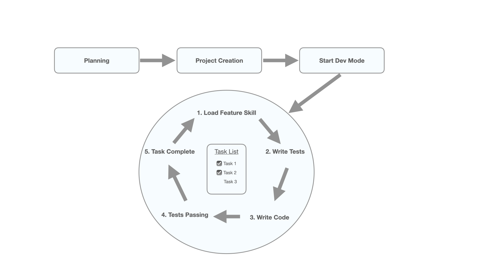


## Notes when using TechZone VM

* To copy and paste between your local laptop and the TechZone RHEL VM, you must use the native keyboard shortcut for Linux (`Control+C` and `Control+V`). Alternatively, you can open the remote sidebar by entering `Ctrl+Cmd+Shift` and change the input to "Text Input". This will allow you to use your local laptop keyboard shortcuts.  

* If this is the first time using IBM Bob on the VM, you may be asked to enter a keyring password. This is to _set_ a keyring password and can be any string you choose. It is not necessary to remember the password for this lab. 

## Creating a new application

For this lab, you will be creating a business expense tracker application. It will leverage the capabilities of IBM Bob along with a custom set of Liberty development skills to guide the agent.  

1. Each TechZone VM should already have the necessary tooling installed and setup complete. If this is not the case or a reinstall is required, please complete the [Installation of Liberty MCP Tools](#installation-of-liberty-mcp-tools) and [Setup workspace](#setup-workspace) sections at the bottom of this guide.
   
1. Log into IBM Bob 

    Open IBM Bob from the app tray (See note above about keyring prompt on first time use). From the IBM Bob chat window, click "Log in to Bob". This will redirect to a web browser page where you can enter your IBM id credentials to log in. You will then be redirected back to IBM Bob.

1. Verify MCP tools are available

    1. From the IBM Bob chat panel on the right side of the IDE window, click on the "gear" icon at the top. 

    1. From the Bob Settings window, click on "MCP" in in the left menu column.

    1. Ensure that `liberty-ldm` and `liberty-tools-mcp` both have a green "Connected" status. If the status is not "Connected", click on MCP entry and then click the "Refresh" icon on the top of the next page. 

    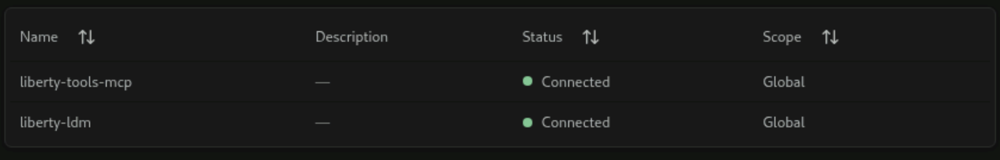
   
1. Ask the following in the Bob chat window:

   ```
   "Let's create a new Liberty application."
   ```

   You will be asked to approve the use of a custom planning tool which will walk through a series of questions about the application you want to create. This is used to provide a structured set of technical specifications that Bob will use to create the starter project. It will also use this information to create an opinionated list of development tasks that it will then iterate over to complete the initial implementation for the app. 

   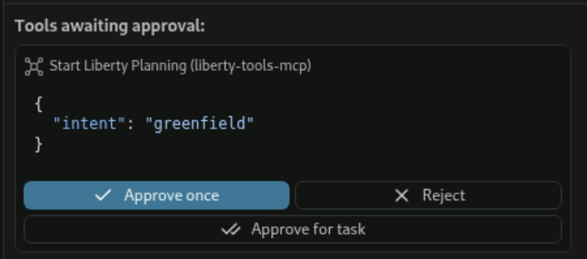

   You can provide the following answers. 

   * When asked for a description of the application, respond with
       ```
       "This will be a business expense tracker application that will allow employees to log expenses from a set list of categories."
       ```
         
   * When asked for the type of application, select `Full-stack`.
   * When asked for the type of build tool, select `Maven`.
   * When asked for the Java level, select `Java 21`.
   * When asked for the Jakarta EE level, select `Jakarta EE 11`.
   * When asked for the MicroProfile level, select `MP 7.1`.
   * When asked where to create the new project, respond with
       ```
       "Create it in this current workspace directory."
       ``````
   * When asked for advanced options select `No, use sensible defaults`.

1. Review plan and begin project creation

   Bob will present a summary of the choices made. If all looks good, simply respond with 
   ```
   "Yes, begin."
   ``` 

1. Approve and complete all to-do list items and subsequent MCP tool and skill loading.

   Bob will display a to-do list of items to create the new application. Throughout this process, Bob will invoke custom MCP tools and skills, each one requiring your approval. The application itself is generated using the [Open Liberty starter](https://openliberty.io/start/), the configuration is trimmed down to optimize initial startup, and a custom version of the Liberty Maven plugin is added to the pom.xml. 

   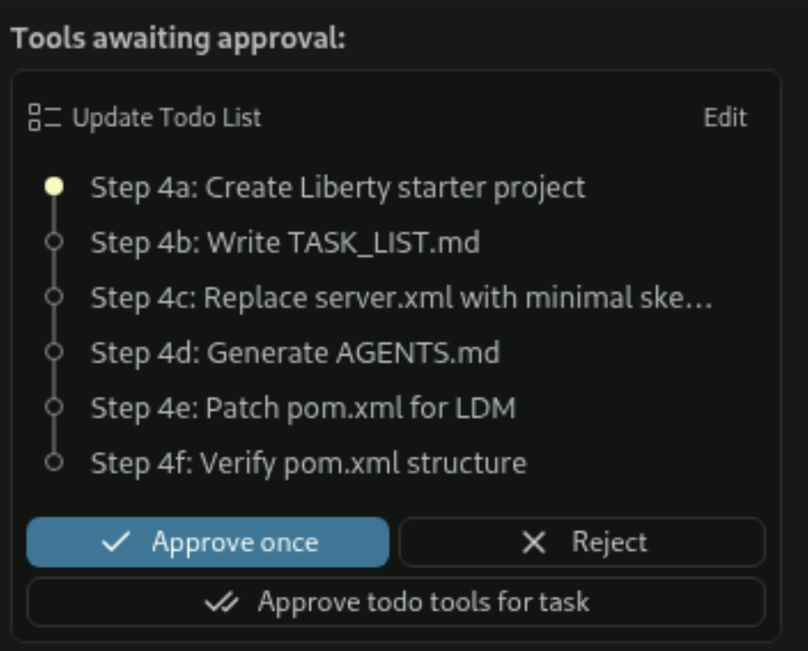
   

1. After all to-do list items are complete, review development task list and begin development

   When project creation is complete, you will notice a new application in your IDE workspace called `expense-tracker` along with custom `AGENTS.md` and `TASK_LIST.md` files. 
   
   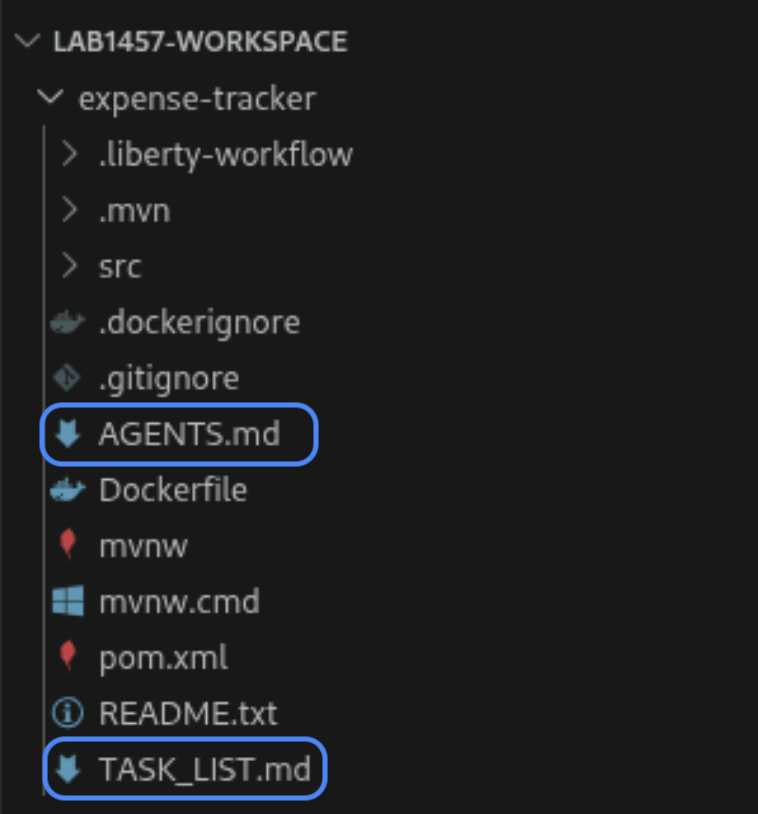
   
   AGENTS.md will govern the overall development process from here on out including runtime management and completing each development task. TASK_LIST.md contains a list of development tasks that have been generated by Bob in order to complete the requirements specified for the application. Bob will perform test driven inner loop development on each of the tasks using the specified feature technology until complete. Once complete, you can continue to enhance and add to the application and Bob will append to this list. 

   Bob will display the current task list in the chat window and ask if you are ready to start development. Respond with:

   ```
   "Yes, begin development."
   ```

## Developing the app

From this point forward, the generated `AGENTS.md` will control the application development workflow and load all apropriate skills and tools as needed. Development begins with starting dev mode and continues by iterating through each development task in the task list. Test driven inner loop development is implemented on each task until all outstanding work is complete. 

1. Start dev mode

    The first task that Bob will perform is starting dev mode. When prompted, click `Approve` for the series of tools and skills used to launch dev mode and verify that the runtime is started.

    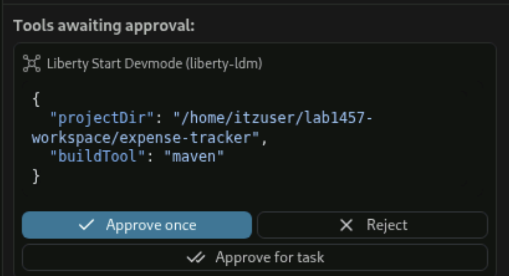

    Once dev mode is started for this app, you should see a message like this:

    `Server is STARTED on port 9080. Enabling hot tests now.`

    Hot testing will then be enabled and the agent will read the first development task from the list.

1. Enter development loop for first task. 

    For each task in the task table, the following steps will be taken to complete the inner loop development cycle. Click `Approve` when prompted at each step. 

    1. Load `test-driven-inner-loop` skill

        This skill governs the overall steps used to complete each task of work. Liberty feature and testing skills will be loaded, tests written, code implemented, and the status for each task updated. 

        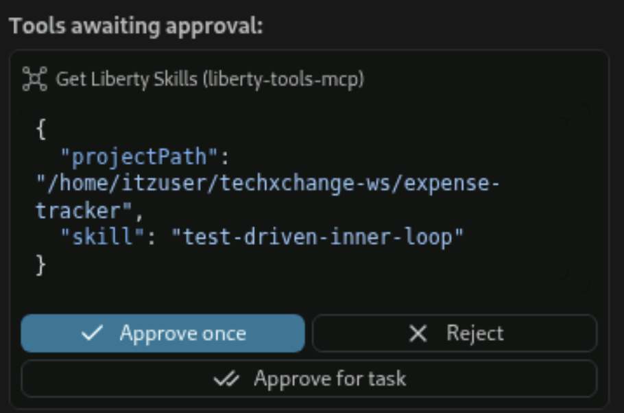

    1. Load Liberty feature skill

        Each task in the task list has a Jakarta EE or MicroProfile feature associated with it. This set of tooling includes specific skills for each of these features which provide guidlines for proper code implementation. At the start the inner loop, the appropriate feature skill is loaded to guide development.

        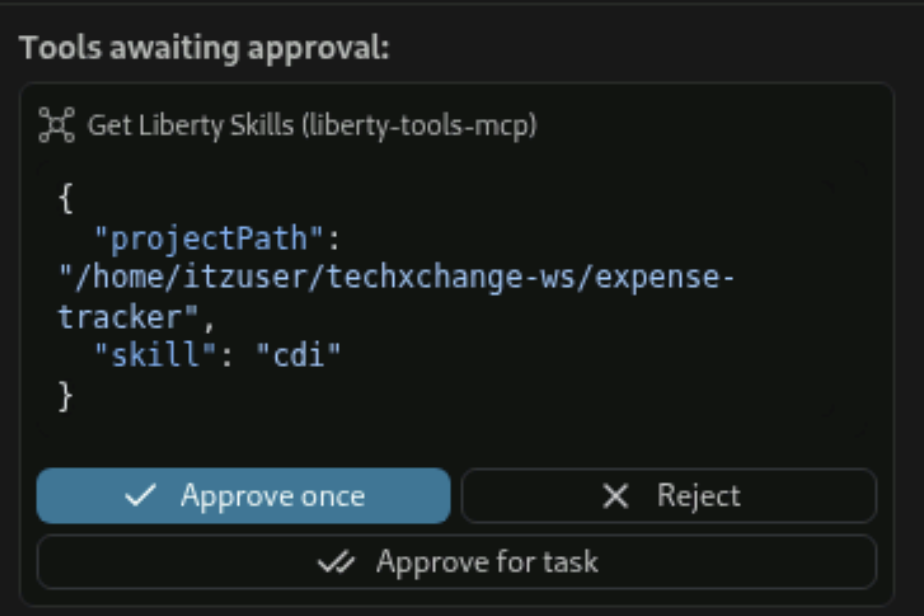

    1. Add feature to Liberty `server.xml``

       Once the feature skill is loaded, Bob will add the correct feature to the Liberty server.xml based on the level of Jakarta EE and Microprofile specified for the application. 

       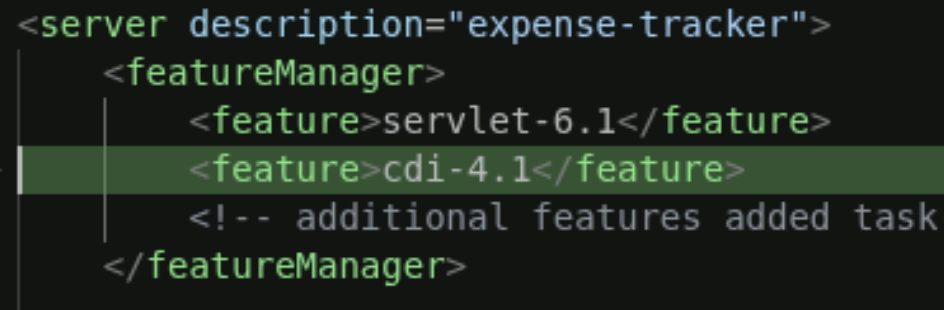

    1. Load the `liberty-testing` skill

       Along with the feature skill which guides code implementation, a custom liberty-testing skill is also loaded to guide test implementation. This skill manages items such as adding Maven or Gradle test plugins.

       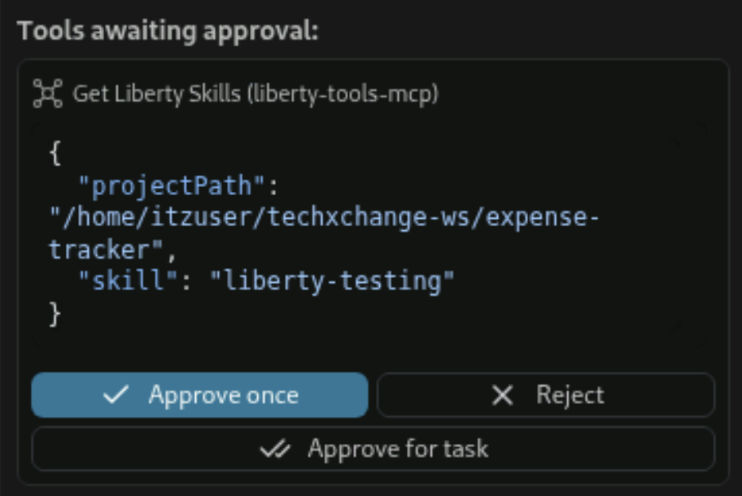

    1. Confirm or add test dependencies and `maven-surefire-plugin` to pom.xml

       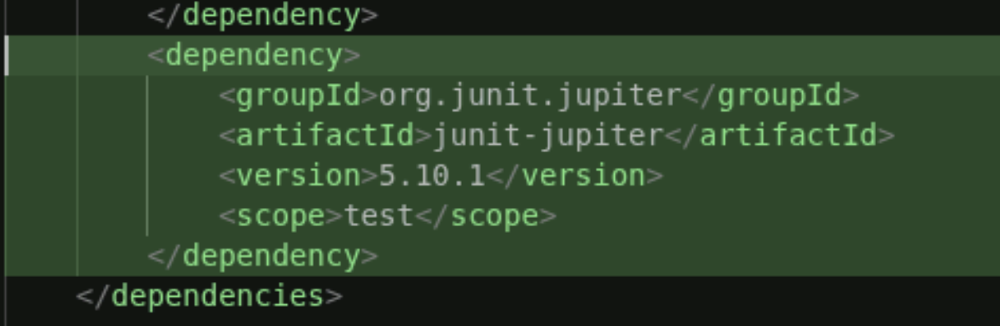 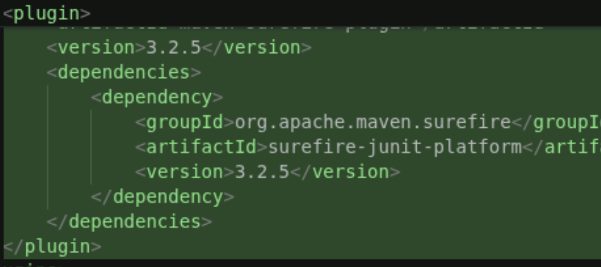

    1. Write class stub for necessary classes.

       The inner loop model is following a test driven development pattern. Tests are written before code is implemented in order to ensure proper functionality upfront. Basic class stubs are needed to ensure tests compile and run. 

       Once stubs are written, runtime logs are checked to ensure dev mode properly compiled the new classes. 

    1. Write test classes.

        After tests are written, the status for this particular task will be updated to `TESTS_WRITTEN`.

    1. Run tests to confirm expected failure.

       Since code has not yet been implemented, per the test driven development pattern these new tests are expected to fail. The task table status will now be updated to `TESTS_FAILING`.

    1. Write code implementation

       Once the actual implementation code is written, Bob will check the dev mode output to make sure all tests are now passing, fixing any failures. Once complete the status of the task will be updated to `DONE`.

1. Move on to next task. 

    When one task is complete, Bob will ask if you are ready to continue on to the next task. 
    
    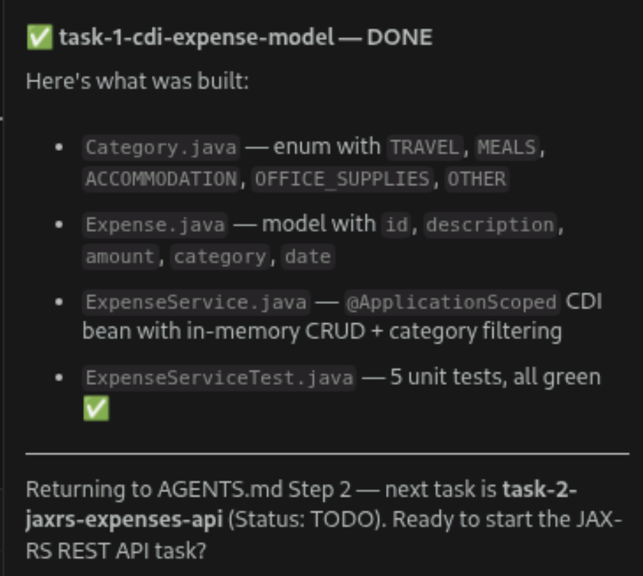
    
    To proceed, respond with:

    ```
    Proceed with next task
    ```

    Then follow through the inner loop again as outlined above.

1. Review completed app

    Once all work is complete, Bob will give a summary of the work that was done and an endpoint where the app is running. Open up a browser to view and use the app and report any functional issues or missing implementation in the chat window for Bob to fix. 
    
    At this point, you should have a basic expense tracking application with input fields for cost and category. 

## Adding more function

Now that the initial development tasks have been completed for this project, IBM Bob can be used along with the Liberty development skills to continue adding functionality to the application. This process can also be used to continue development for any existing application that is new to this tooling suite. 

1. Invoke IBM Bob to add edit capabilities to existing expenses in the list.

    ```
    "Let's add an enhancement to allow users to edit existing expenses in the list."
    ```

1. Approve the planning skill 

    Bob will use lightweight planning skill to confirm the state of the app and add the new development request to the task list. 

1. Once the plan is in place, Bob will iterate over each new task in the list following the same test driven inner loop pattern as before. 

***
<p align="center">Lab is complete</p>
<br>
<br>

## Installation of Liberty MCP Tools

1. Clone this repository
   ```
   git clone git@github.com:IBM/application-development-accelerators.git
   cd application-development-accelerators/txc1457
   ```

1. Run install.sh
   ```
   chmod 777 install.sh
   ./install.sh
   ```

## Setup workspace

1. From a terminal window, create a new workspace directory.

    ```
    mkdir ~/lab1457-workspace
    ```

1. Open the new directory in IBM Bob.

    On the left panel of the IDE click "Open Folder". Find and select the new workspace directory. 

1. Trust the new workspace directory to enable all IBM Bob features.

    IBM Bob runs in "Restricted Mode" by default for new workspaces. To trust the workspace, click "Manage" at the top notification banner.
   
    

    Then select "Trust" on the next pop-up window. 
    
    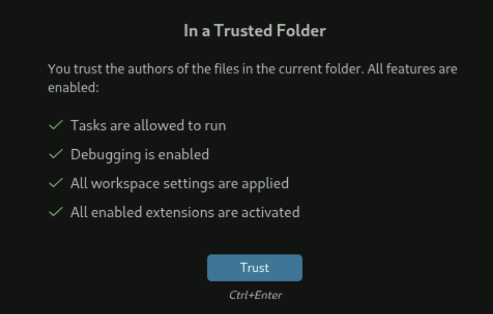
